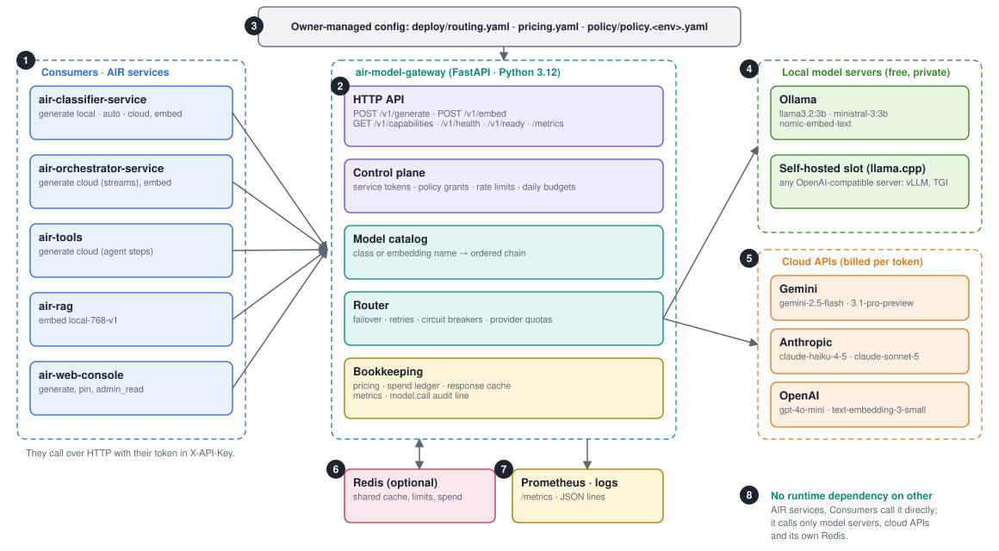
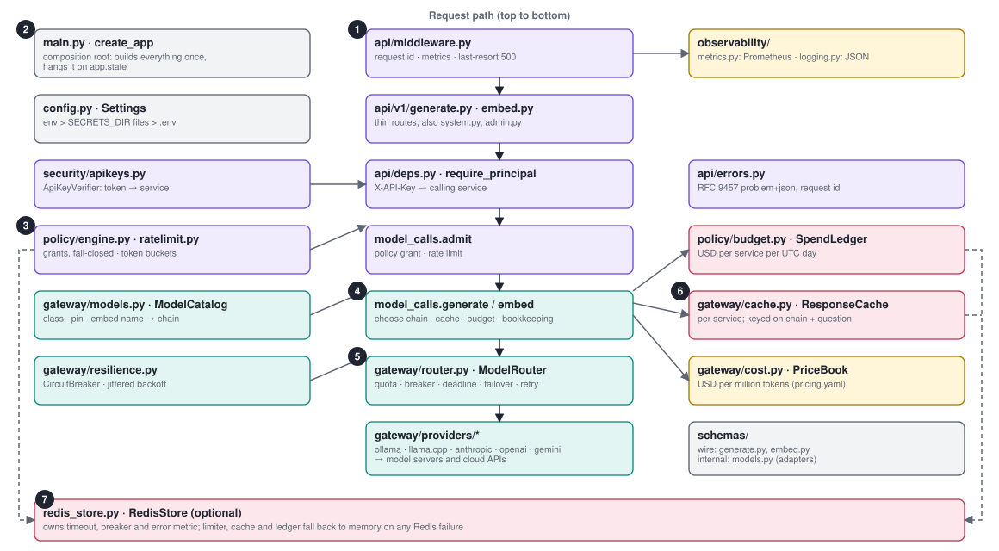
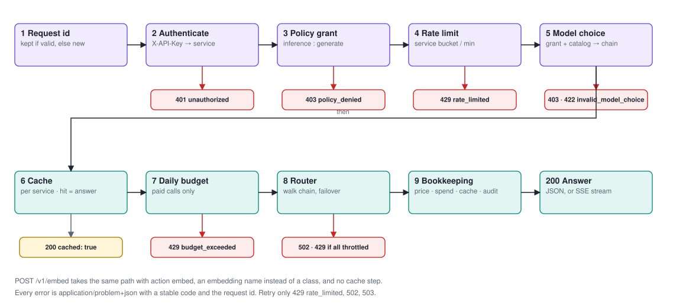
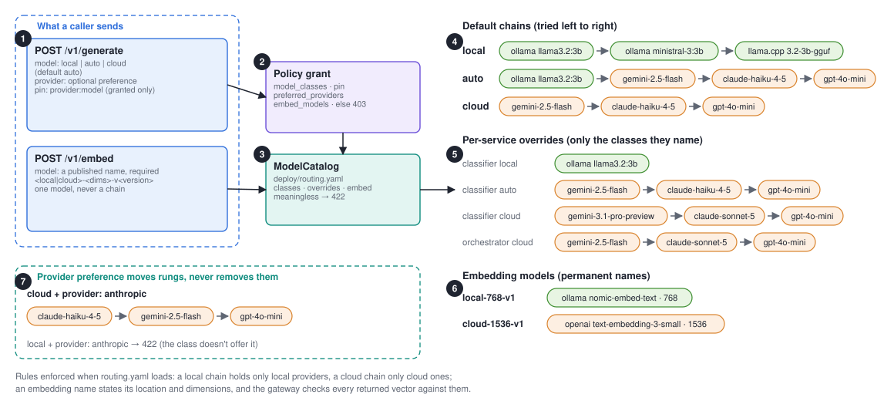
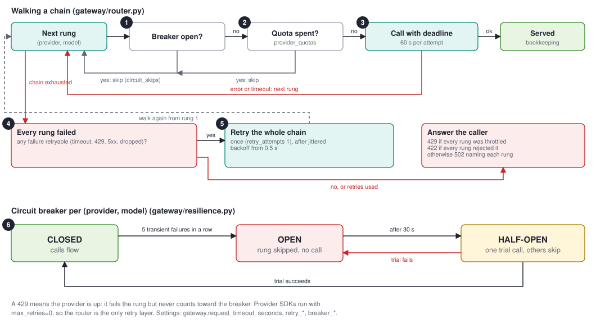
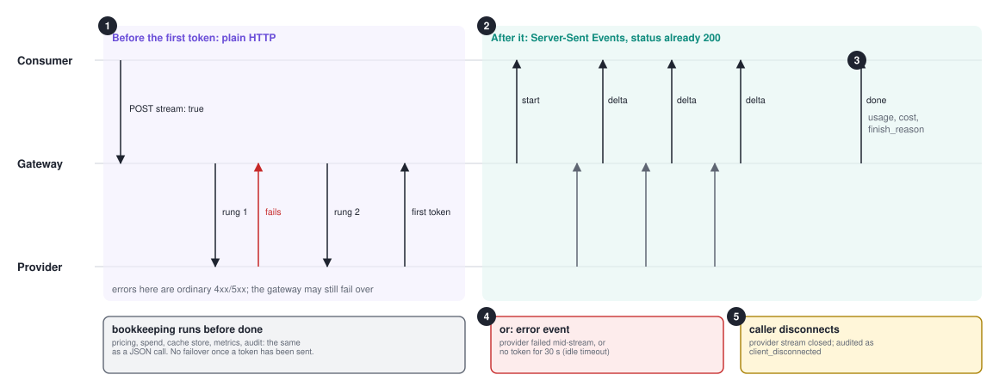
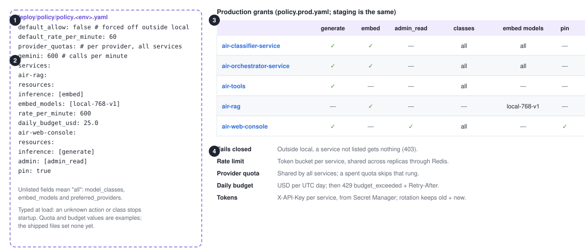
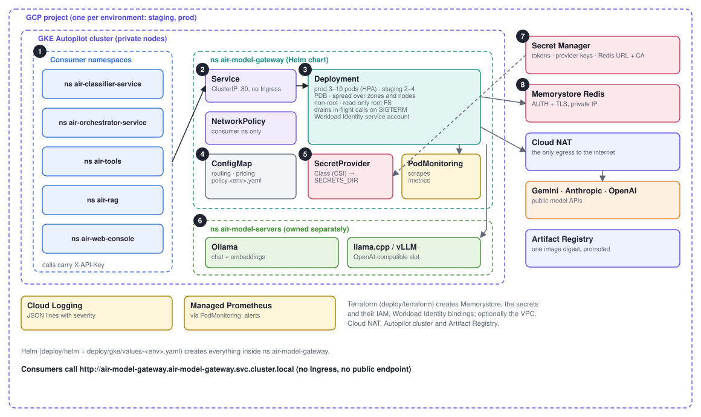
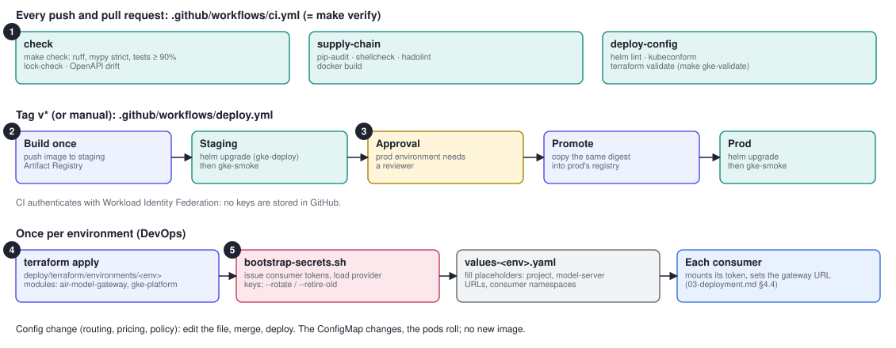
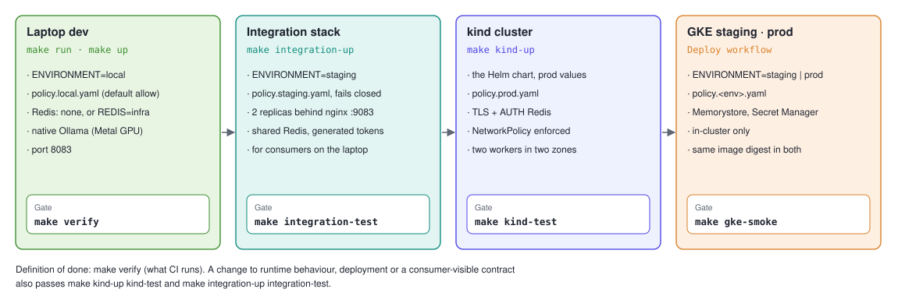

# air-model-gateway

The AIR platform's model gateway: `POST /v1/generate` for text (optionally structured
JSON) and `POST /v1/embed` for vectors, across Ollama, Anthropic, OpenAI, Gemini and
any OpenAI-compatible self-hosted server (llama.cpp, vLLM, TGI). Services choose a
model class (`local`, `auto`, `cloud`) or a published embedding model, never a model
name; the gateway handles model selection, authentication, permissions, rate limits,
failover, retries, circuit breaking, cost accounting, caching and observability.

## Visual design

**[AIR Model Gateway · Visual Design (PDF)](docs/air-model-gateway-design.pdf)**: 14
printable A4-landscape pages that give development and DevOps teams the whole picture:
every component, how they are wired, how consumers integrate, and how it is deployed
and operated. Each page is one diagram with short numbered notes; keep it at hand for
design discussions and onboarding.

| Page | Topic | What it shows |
|---|---|---|
| 2 | System context | Consumers, the gateway, local and cloud models, Redis, config, observability |
| 3 | Components | Every module under `src/`, the request path through them, and what they share |
| 4 | Request flow | `/v1/generate` step by step, with each early exit (401, 403, 422, 429, 502) |
| 5 | Model choice | Classes, provider preference, pins, embedding names, today's chains and overrides |
| 6 | Resilience | Chain walk, quotas, deadlines, the retry rule, the circuit breaker |
| 7 | Streaming | Server-Sent Events: what can fail before and after the first token |
| 8 | Governance | The policy file, each consumer's grants, rate limits, quotas, budgets |
| 9 | API quick reference | Endpoints, headers, request and response bodies, errors, retry advice |
| 10 | GKE deployment | Namespaces, the Helm chart, Secret Manager, Memorystore, egress |
| 11 | Delivery pipeline | CI gates, build once, staging, approval, promotion, one-time setup |
| 12 | Environments and gates | Laptop, integration stack, kind, GKE, and the command that proves each |
| 13 | Observability and operations | Metrics, the audit line, first alerts, troubleshooting |
| 14 | Repository map and ownership | Layout, who changes what, design principles |

The diagrams, as GitHub shows them:









<details>
<summary>Resilience, streaming, governance, deployment, delivery and environments</summary>













</details>

The PDF and the SVGs are generated from `docs/design/` (`diagrams.py` draws the
diagrams, `design.html` lays out the pages). After a change to the system, update the
source and run `make design` (needs Google Chrome or Chromium).

## Capabilities

- **One contract for every provider.** Generation (with optional JSON-Schema
  structured output, optionally streamed as Server-Sent Events) and embeddings, each on
  its own route.
- **Model classes, not model names.** Callers choose `local`, `auto` or `cloud` (and
  optionally a preferred provider) for text, or a published embedding model such as
  `local-768-v1`. `deploy/routing.yaml` maps each to concrete models, per service if
  needed: an ordered chain with a deadline per attempt and failover on errors.
- **Resilience.** A per-model circuit breaker skips rungs that keep failing. Transient
  failures (timeout, 429, 5xx) get one jittered retry of the chain.
- **Cost accounting.** Every call is priced from `deploy/pricing.yaml`. Local models are
  free, and unpriced models are counted, not hidden.
- **Response cache.** Identical chat requests from the same service are served from
  cache at zero cost.
- **Own control plane.** Per-service tokens and rate limits, an RBAC policy file,
  quotas per provider across services, daily budgets per service, and grants for which
  model choices each service may make. Policy fails closed outside `local`.
- **Scales out with Redis.** The cache, rate limits, quotas and spend move to Redis when
  `REDIS__URL` is set. If Redis is unreachable, the gateway degrades instead of failing.
- **Observability.** Structured logs, one audit line per call, Prometheus metrics, and
  RFC 9457 error bodies carrying the request ID.

## Quick start

```bash
make dev                  # .venv from the lock: runtime, provider SDKs, dev tools
cp .env.example .env      # add any cloud API keys you have
make check                # lint + typecheck + tests (no network needed)
make verify               # every gate CI runs (the definition of done)
make run                  # serve on :8083 against native Ollama (REDIS=infra to share state)
```

```bash
curl -X POST localhost:8083/v1/generate \
  -H "X-API-Key: air-classifier-dev" -H "Content-Type: application/json" \
  -d '{"model":"local","messages":[{"role":"user","content":"Say hi"}]}'
```

`make help` lists every command. `make up` runs the production image under Docker
Compose instead, and `make integration-up` / `make integration-test` run a two-replica,
staging-configured stack on `:9083` for integration testing with other AIR services.

## Production (GKE)

Staging and production run on GKE from one Helm chart (`deploy/helm/`), with GCP
resources in Terraform (`deploy/terraform/`). Those resources are Memorystore, Secret
Manager and Workload Identity, plus an optional Autopilot cluster. A GitHub Actions
workflow builds once and promotes the same image digest from staging to prod. On a
laptop, `make gke-validate` checks the chart and Terraform, and `make kind-up` /
`make kind-test` run the production chart on a local kind cluster.
[`docs/03-deployment.md`](docs/03-deployment.md) is the runbook.

## Configuration

Settings are environment variables prefixed `AIR_MODEL_GATEWAY_`; `.env.example`
documents every one. In shared environments, secrets can also be files in
`AIR_MODEL_GATEWAY_SECRETS_DIR`, which is how Vault Agent, Kubernetes secrets and the
cloud secret-store drivers deliver them. Routing, pricing and permissions live in
`deploy/` and change with an edit and a restart, not a release.

## Layout

| Path | Purpose |
|---|---|
| `src/air_model_gateway/` | The service: API, control plane, router, providers, cache, metrics |
| `src/air_model_gateway_client/` | Reference Python client (separate import package, same wheel) |
| `deploy/` | Routing, pricing and policy files; what gets deployed (`helm/`, `gke/`, `terraform/`); laptop-only harnesses (`local/`) |
| `.github/workflows/` | CI (`make verify`'s gates) and the staging → prod deploy |
| `tests/` | Unit and in-process end-to-end tests |
| `docs/` | Overview, scope, design, deployment, integration, handover; the OpenAPI contract |
| `AGENTS.md` | Rules for changing the code, for engineers and any coding agent |

## Documentation

- [`docs/air-model-gateway-design.pdf`](docs/air-model-gateway-design.pdf): the visual
  design, printable; the quickest way to the big picture.
- [`docs/overview.md`](docs/overview.md): **start here.** Architecture, request flow,
  consumers, the purpose of every file, running, testing and operating.
- [`docs/00-plan.md`](docs/00-plan.md): scope, goals, non-goals and key decisions.
- [`docs/01-hld.md`](docs/01-hld.md): high-level design and failure behaviour.
- [`docs/02-lld.md`](docs/02-lld.md): settings, contracts and module internals.
- [`docs/03-deployment.md`](docs/03-deployment.md): GKE runbook: provisioning,
  deploying, rotating secrets, operating.
- [`docs/04-integration.md`](docs/04-integration.md): for consuming teams: access,
  calls, errors and retries, timeouts, testing.
- [`docs/05-handover.md`](docs/05-handover.md): how the project is verified, the
  gates, traceability, risks and their guards, open items. Agents and engineers:
  [`AGENTS.md`](AGENTS.md).
- [`docs/06-consumer-migration.md`](docs/06-consumer-migration.md): per-service steps
  to move to `/v1/generate` and `/v1/embed`, and to adopt streaming.
- [`docs/openapi.json`](docs/openapi.json): the API contract (OpenAPI 3.1); generate
  clients from it. Served live at `/docs` on a running gateway.
