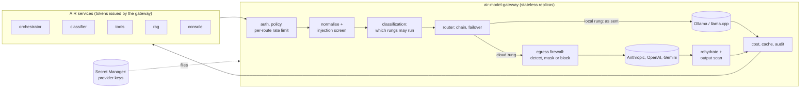

# AIR Model Gateway — Core Infrastructure and AI Firewall (Proposal)

**Status:** proposed, for the owner's review. Nothing here is implemented yet; §12
lists the decisions to confirm before development starts.

**Companion docs:** [Plan](00-plan.md) · [HLD](01-hld.md) · [LLD](02-lld.md) ·
[Integration](04-integration.md) · [Handover](05-handover.md)

This proposal makes the gateway the platform's **AI firewall**: every prompt and every
text to embed is inspected before it can leave for a cloud provider. Personal data
(PII) and business-sensitive data are masked or blocked, prompt injection is screened,
and answers are restored ("rehydrated") before they go back to the caller. It is
designed to fit the gateway as it is built today (stateless, policy-driven, one
request path through `api/v1/model_calls.py` and `gateway/router.py`), and to arrive
in phases that each pass the release gate in [05-handover.md](05-handover.md) §2a.

## 1. The brief against the gateway today

Much of the brief is already true. The table shows where each point stands, so
development effort goes only to the gaps.

| Brief | Today | Proposal |
|---|---|---|
| Stateless intermediary between callers and cloud providers | Yes. No conversation state: callers send the whole history on every call ([04-integration.md](04-integration.md)) | Unchanged. The rehydration map (§5.3) lives only for one request |
| History, context trimming and sessions in the orchestrator | Yes, by design | Unchanged |
| Provider keys only in the gateway; callers use gateway-issued tokens | Yes. Per-service tokens; provider keys come from Secret Manager as files (`SECRETS_DIR`), env vars locally | Unchanged. Files are kept in preference to env vars: env vars leak through process listings, crash dumps and child processes |
| `/v1/generate` unary or SSE, schemas in OpenAPI | Yes (`docs/openapi.json`, streaming with `start`/`delta`/`done`/`error`) | Streaming learns to rehydrate placeholders split across deltas (§5.3) |
| `/v1/embed` unary, deterministic | Yes, one published model per name, never failover | Add a per-text embedding cache (§8.2) |
| Response caching at the route middleware layer | `/v1/generate` is cached per service, inside `model_calls`; `/v1/embed` isn't cached | Cache embeddings inside `model_calls`, **not** in HTTP middleware (§8.2 explains why) |
| Sequential firewall: regex, NER (Presidio), injection guardrails | None. Only size limits and schema validation | §4 to §7: the main body of this proposal |
| Separate rate-limit queues per route | One bucket per service shared by both routes (`(service, "inference")`) | Per-route buckets, per-route concurrency limits, optionally a separate deployment for bulk embedding (§8.1) |

The brief places the gateway between the **orchestrator** and the cloud. The gateway
serves five consumers today (classifier, orchestrator, tools, rag, the console), and
the firewall applies to all of them: data leaves for the cloud through every one.

## 2. Principles

1. **Protect at egress, per rung.** The data-protection goal is "nothing sensitive
   reaches a cloud provider". Our own model servers (`ollama`, `llama.cpp`) are inside
   the network, so a rung on a local provider receives the request as sent. A cloud
   rung receives the inspected, masked request. The decision is made per rung because
   a chain can mix both: `auto` starts local and fails over to cloud. This also keeps
   the expensive inspection off the bulk of local traffic, such as air-rag's
   `local-768-v1` ingestion.
2. **Fail closed toward the cloud.** If an inspection stage errors or times out, cloud
   rungs are skipped (never sent unmasked) and local rungs still serve. A chain left
   with nothing is an error the caller can see.
3. **Values never leave the request.** Detected values are never logged, never put in
   metrics or error details, never written to Redis, and never echoed in a 422. The
   audit line records counts per entity type and the action taken.
4. **Deterministic first, models second.** Cheap, explainable, checksum-validated
   patterns run first; the NER model handles what patterns can't; injection
   classifiers flag rather than decide until their false-positive rate is measured.
5. **Policy is configuration.** Which entities are masked or blocked, per data
   classification and per service, lives in owner-managed YAML next to the policy
   files, validated at load, and enforced strictly outside `local`, like budgets.
6. **Monitor before enforce.** Every new detector ships in `monitor` mode (it counts
   and audits what it would have done) and moves to `enforce` per service once
   staging metrics show an acceptable false-positive rate.

## 3. Topology

The gateway still holds no conversation state. The shared state it already has (the
response cache, rate-limit buckets, spend ledger) is infrastructure state in Redis and
stays the only shared state. Nothing the firewall learns about a request outlives that
request.

## 4. The pipeline and where it sits in the code

### 4.1 Why not HTTP middleware

The brief asks for a middleware pipeline. The stages run in a fixed, strict order, as
asked, but not as Starlette HTTP middleware, for three reasons:
- **Middleware runs before authentication and policy.** It can't know which service is
  calling, so it can't apply that service's policy, and caching there would share
  answers across services.
- **Only the router knows where the data is going.** Whether a rung is local or cloud
  is decided rung by rung during failover (§2.1). Middleware sees the request once,
  before any of that is known.
- **Streams and structured output need the parsed request.** Rehydrating a stream means
  working on decoded text deltas, not response bytes.

So the firewall is a new package, `guardrails/`, called at two existing seams, the way
provider quotas are today (an `admit` callback the router calls per rung):

| Seam | Where | Runs |
|---|---|---|
| **Ingress** | `api/v1/model_calls.py`, after `admit` (auth, policy, rate limit) and before the cache lookup | Normalisation, injection screen, classification (which rungs may run), and one detection pass whose result is reused by every cloud rung |
| **Egress** | `gateway/router.py::_walk`, before each cloud rung's call (a new `egress` callback beside `admit`) | Apply the masking plan to that rung's request; skip the rung if the plan says block or the firewall failed |
| **Return** | `model_calls` (non-streamed) and `_relay` (streamed), before bookkeeping | Rehydrate, output scan, then cache and audit as today |

### 4.2 The stages, in order

| # | Stage | Input | On a hit |
|---|---|---|---|
| 0 | Validation and size limits | Wire body | 422 (exists today) |
| 1 | Normalisation | Every message, every embed text | Unicode NFKC, zero-width and bidi control characters removed, so patterns and classifiers can't be bypassed by look-alike characters. The normalised text is what gets sent |
| 2 | Injection screen (Pillar 3, §7) | User and untrusted messages | `monitor`: count and audit. `enforce`: 422 `content_blocked` |
| 3 | Classification (§6) | The request's `data_classification`, or the service's default | Cloud rungs dropped when the class doesn't allow cloud; 422 `classification_conflict` if no rung is left |
| 4 | Deterministic detection (Pillar 1, §5.1) | Text bound for a cloud rung | Per entity: `mask`, `block`, or `allow` |
| 5 | Contextual detection (Pillar 2, §5.2) | The same text | Per entity, as above |
| 6 | Egress | The masked request | Sent to the cloud rung; the placeholder map stays in the request |
| 7 | Rehydration (§5.3) | The provider's answer | Placeholders replaced by the original values |
| 8 | Output scan (§5.4) | The rehydrated answer | Secrets and identifiers the caller never sent are masked |
| 9 | Audit and metrics (§9) | Counts only | One `model.call` line, extended |

Stages 4 and 5 run once per request, at ingress, and only when the chain has a cloud
rung the classification allows. A request served entirely by local rungs skips them.

## 5. Data protection

### 5.1 Pillar 1: deterministic detection

Patterns are validated wherever a checksum exists, which is what keeps false positives
low enough to enforce:

| Entity | Detection | Default action to cloud |
|---|---|---|
| Credit card numbers | 13–19 digits with separators, **Luhn check** | block |
| Bank accounts (IBAN) | Country format plus **mod-97 check** | mask |
| Secrets and keys | Known prefixes (`sk-`, `AKIA`, `ghp_`, `xox`, `AIza`, PEM private-key blocks, JWTs) plus a high-entropy token rule | block |
| Email addresses | RFC 5322 subset | mask |
| Phone numbers | Presidio's phone recogniser (libphonenumber), so formats per region | mask |
| IP addresses | IPv4 and IPv6, private ranges included (internal topology is sensitive) | mask |
| National identifiers | US SSN; for India: Aadhaar (**Verhoeff check**), PAN, GSTIN | block |
| Corporate identifiers | Owner-configured patterns: customer and account ids, internal hostnames and domains, project codenames (a word list) | mask |
| Financial figures | Owner-configured **proximity rules**: a currency amount or percentage within a few words of terms such as revenue, EBITDA, margin, forecast, salary | mask (the number only) |

**An honest limit:** no pattern reliably recognises "business-sensitive" content in
general. A paragraph about an unannounced acquisition has no format. Patterns catch
structured values and configured vocabularies. For unstructured sensitive content the
dependable control is classification (§6): the caller declares the data
`confidential` or `restricted`, and the gateway keeps it off cloud rungs entirely.

### 5.2 Pillar 2: contextual PII (Presidio)

- **Engine:** Microsoft Presidio Analyzer and Anonymizer, in-process, with a spaCy
  pipeline. The Pillar 1 patterns are registered as Presidio custom recognisers, so
  there is one analysis pass, one result format and one place to tune thresholds.
- **Entities:** `PERSON`, `LOCATION`, `NRP` (nationality, religion, politics) and
  `ORGANIZATION` (off by default: it is the noisiest). `DATE_TIME` stays off. Each has a
  score threshold in `guardrails.yaml`.
- **Model choice:** `en_core_web_lg` (about 560 MB) is the recommended start: the
  best accuracy CPUs can run in tens of milliseconds. Transformer pipelines are more
  accurate but need GPUs for acceptable latency. This is a decision to confirm (§12).
- **Packaging:** an optional `guardrails` dependency extra, imported lazily like the
  provider SDKs. The production image grows by roughly 0.7 GB; replicas need more
  memory (budget about 1 GiB extra). Analysis is CPU-bound, so it runs in a worker
  thread pool, never on the event loop, with its own deadline.
- **Language:** English first. Text the language detector can't place in a supported
  language is treated as unscanned: allowed with a flag for `internal`, kept off cloud
  for `confidential` and above.
- **Placeholders:** typed and numbered per request, `[PERSON_1]`, `[EMAIL_2]`. The same
  value always gets the same placeholder within a request, so the model can still
  reason ("[PERSON_1] emailed [PERSON_2]"). A short system note tells the model to keep
  placeholders verbatim.

### 5.3 Rehydration

- **The map:** placeholder → original value, built at ingress, held only in the
  request's memory, released when the response finishes. Never in Redis, never logged,
  never shared between replicas. This is what keeps the gateway stateless.
- **Non-streamed answers:** replace each placeholder in `content`. For structured output
  the replacement happens inside JSON string values, with JSON escaping applied, so the
  answer stays valid JSON.
- **Streams:** a placeholder can arrive split across deltas (`[PERS` then `ON_1]`). The
  relay holds back text from a `[` until the matching `]` or 32 characters, whichever
  comes first, then releases it rehydrated. Perceived latency grows by at most one
  placeholder's length.
- **Model drift:** models sometimes alter a placeholder (`[Person_1]`, `[PERSON 1]`).
  Matching is case- and spacing-insensitive. A placeholder that isn't in the map passes
  through unchanged and is counted.
- **Opt-out:** a service can choose `mask_only` (no rehydration), so even the answer
  holds no restored values, for example when the answer goes to a cloud-hosted UI.

### 5.4 Output scan

The answer is scanned with the Pillar 1 secret and identifier patterns after
rehydration. A value the caller didn't send (a model reproducing a key or an id from
training data, or from another rung's context) is masked and counted. Values the caller
sent and that were rehydrated are left alone.

### 5.5 Embeddings

Masking changes what a text means, and a vector can't be rehydrated. So:
- **Local embedding models** (`local-768-v1`): no masking. Nothing leaves the network,
  and retrieval quality is untouched. This is the recommended home for all sensitive
  corpora.
- **Cloud embedding models** (`cloud-1536-v1`): allowed only up to `internal`. Masking,
  when on, uses **unnumbered** type tokens (`[PERSON]`), identical for every text, so
  query and document vectors stay comparable across calls.

## 6. Data classification

The strongest control, and the cheapest: the caller says how sensitive the data is.

| Class | Cloud rungs | Masking to cloud | Cache |
|---|---|---|---|
| `public` | Allowed | Secrets blocked only | As today |
| `internal` | Allowed | Pillars 1 and 2, per `guardrails.yaml` | As today |
| `confidential` | Allowed only for services whose policy says so | Pillars 1 and 2, every entity masked, secrets and national ids blocked | Off |
| `restricted` | Never: local rungs only | Not applicable | Off |

- **Wire:** an optional `data_classification` on `/v1/generate` and `/v1/embed`. An
  additive change; callers that don't send it get their service's default.
- **Policy:** per service, `default_classification` and `max_cloud_classification`.
  A request above the service's ceiling has its cloud rungs dropped.
- **Classes and chains:** `local` chains satisfy every class. `cloud` with `restricted`
  is a 422 `classification_conflict`. `auto` keeps its local rungs. A `pin` to a cloud
  model follows the same rule.
- **Cache:** off for `confidential` and `restricted`, so their answers never reach
  Redis.

## 7. Pillar 3: prompt-injection guardrails

What a gateway can and can't do here should be explicit:
- **It can** screen text for known injection and jailbreak patterns, and run a small
  classifier, before a model sees it.
- **It can't** decide whether a tool call is safe: it doesn't know the orchestrator's
  tools or permissions. Least-privilege tools, argument validation and human approval
  for consequential actions stay in the orchestrator. No injection detector is
  reliable enough to be the only defence.

The layers, cheapest first:
1. **Signatures:** instruction-override phrases ("ignore previous instructions"),
   system-prompt extraction attempts, role-play jailbreak markers, invisible Unicode
   and long base64 or hex blobs in user text. Deterministic, sub-millisecond, shipped
   as a versioned list.
2. **A local classifier:** Meta's Prompt Guard (86M parameters, CPU-feasible) for
   injection and jailbreak scores, or Llama Guard 3 (1B) served by the Ollama the
   gateway already uses, for policy categories. Local by construction, so screening
   never sends text to the cloud. A score threshold per service, a deadline, and
   fail-open-with-flag on timeout (the data protection above still applies).
3. **Untrusted content:** the most dangerous injections are indirect: text from a web
   page, a document or a tool result. An optional `trust: "untrusted"` on a message lets
   the orchestrator mark such content. Untrusted messages get the strictest screening,
   and are wrapped in delimiters with a system note that they are data, not
   instructions.

**NeMo Guardrails** is a conversation-flow framework that makes its own LLM calls and
keeps dialogue state. It belongs in the orchestrator, if anywhere, not inside a
stateless gateway. The gateway exposes the hook (the ingress stage interface) so a
remote guardrail service can be added later without changing the pipeline.

Actions per service: `monitor` (default for a new service: count, audit, pass) or
`enforce` (422 `content_blocked`, with the detector's category and never the matched
text).

## 8. Infrastructure isolation and scale

The brief's text stops partway through this point ("Massive background RAG ingestion
processes hitting /v1/embed …"). Read as: bulk ingestion on `/v1/embed` must never
slow or starve interactive `/v1/generate` traffic. That is the assumption below;
confirm it (§12).

### 8.1 Separate queues per route

- **Rate limits per route:** buckets keyed `(service, generate)` and `(service, embed)`
  instead of one shared `(service, inference)`. In the policy, `rate_per_minute` accepts
  a map (`{generate: 300, embed: 1200}`); a plain number keeps meaning both, so current
  files stay valid.
- **Embedding throughput in texts:** an embed call carries up to 2,048 texts, so a
  per-call limit says little. Add `embed_texts_per_minute` per service, drawn from the
  same Redis token buckets.
- **Bulkheads:** a per-route concurrency limit per replica (an `asyncio.Semaphore`), so
  embedding batches can occupy at most a set share of a replica. A request over the
  limit waits a short time, then gets 429 `rate_limited` with `Retry-After`.
- **Provider quotas per route:** `provider_quotas` can be split by route, so ingestion
  can't spend the interactive share of a provider account.
- **Optional, for heavy ingestion:** a second deployment of the same image and chart,
  exposed as its own Service and used only by air-rag. Kubernetes then isolates CPU,
  memory and autoscaling completely. One values file, no code.

### 8.2 Embedding cache

Embeddings from a fixed published model are deterministic, so caching them is safe and
very effective for re-indexing.
- **Key:** published name, calling service, SHA-256 of the normalised text. One entry
  per text, not per request, so a batch that is mostly unchanged costs only its new
  texts. Order is kept when cached and fresh vectors are merged.
- **Value:** the vector only. The text is never stored.
- **Lifetime:** days, not minutes (a published name never changes meaning, so a
  cached vector can't go stale). Stored in Redis with the same fallback as today.
- **Where:** in `model_calls.embed`, after auth, policy, budget and classification.
  That's why it isn't HTTP middleware: a middleware cache would answer before the
  caller is identified, sharing vectors across services and bypassing policy and
  budgets.
- **Not for `restricted` or `confidential`:** consistent with §6.

## 9. Observability and audit

New metrics, documented in the LLD's metrics table when built:

| Metric | Labels | Meaning |
|---|---|---|
| `guardrail_detections_total` | route, entity, action | Values found, by type and by what was done (`mask`, `block`, `allow`, `monitor`) |
| `guardrail_blocked_total` | route, stage, service | Requests refused by a stage |
| `guardrail_seconds` (histogram) | stage | Time per stage; the firewall's latency cost |
| `guardrail_failures_total` | stage | A stage errored or timed out (cloud rungs were skipped) |
| `rehydration_misses_total` | route | Placeholders in an answer that weren't in the map |
| `embed_cache_hits_total` | embedding model | Texts served from the embedding cache |

The `model.call` audit line gains `data_classification`, `guardrails` (counts per
entity and action, plus the ruleset version) and `egress` (whether any cloud rung was
called with masked data). It never carries values, placeholders' originals or prompts.

## 10. Errors

| Status | `code` | When |
|---|---|---|
| 422 | `content_blocked` | A stage in `enforce` mode blocked the request: a blocked entity type to cloud, or an injection verdict. `detail` names the stage and entity type, never the value |
| 422 | `classification_conflict` | The classification leaves no rung that may run, such as `cloud` with `restricted` |
| 503 | `guardrail_unavailable` | Only cloud rungs were allowed and the firewall failed for them; retry with backoff |

## 11. Threats and their guards

| Threat | Guard |
|---|---|
| PII or business data sent to a cloud provider | Classification (§6), egress masking per rung (§5), fail closed (§2) |
| Bypass by look-alike characters, zero-width characters or encodings | Normalisation before every stage (§4.2) |
| Secrets in prompts (pasted keys, tokens) | Pattern block before egress; output scan (§5.4) |
| Detected values leaking through logs, metrics, errors or Redis | Values never leave request memory (§2.3); confidential caching off (§6) |
| Rehydration giving one caller another's values | The map is per request, in memory, never shared |
| Direct and indirect prompt injection | Signatures, a local classifier and untrusted-content marking (§7); tool safety stays in the orchestrator |
| CPU exhaustion through expensive inspection | Existing size limits; inspection only on cloud-bound text; thread pool with a deadline; bulkheads (§8.1) |
| Ingestion starving interactive traffic | Per-route buckets, bulkheads, optional separate deployment (§8.1) |
| Cross-service data exposure through caches | Every cache key includes the calling service (today for generate, §8.2 for embed) |

## 12. Decisions to confirm before development

1. **Egress-scoped protection** (§2.1): local rungs receive data as sent; only
   cloud-bound text is masked. Or should local rungs be masked too?
2. **Classification on the wire** (§6): add `data_classification` (additive), with
   per-service defaults and ceilings. Which default per service?
3. **Default actions** (§5.1): the block/mask table, especially blocking credit cards,
   secrets and national ids rather than masking them.
4. **Presidio model** (§5.2): `en_core_web_lg` on CPU, with the image and memory
   growth; and which languages besides English.
5. **Rehydration by default** (§5.3), with `mask_only` as the per-service opt-out.
6. **Injection classifier** (§7): Prompt Guard, Llama Guard 3 on the existing Ollama,
   or signatures only to begin with; `monitor` first everywhere.
7. **Untrusted-message marking** (§7.3): add the optional `trust` field, which the
   orchestrator would then set.
8. **The truncated §4 of the brief:** is §8's reading right? Are a separate embedding
   deployment and text-based limits wanted now?
9. **Business vocabulary** (§5.1): who owns the codename list, account-id patterns and
   financial proximity rules, and where they are reviewed.
10. **Latency budget:** the acceptable p95 the firewall may add to a cloud call.
    Proposed: 50 ms for prompts up to 8,000 characters, measured before enforcing.

## 13. Delivery plan

Each phase is its own change set: spec first (this document, then the LLD), tests,
code, docs, and the release gate.

| Phase | Scope | Proves it works |
|---|---|---|
| 0 | Per-route rate limits and bulkheads; embedding cache; the `guardrails/` package with ingress and egress seams, wired with no stages | Existing tests unchanged; load test shows embed bursts don't move generate p95 |
| 1 | Normalisation; classification on the wire and in policy; Pillar 1 patterns; secrets blocked; audit and metrics | Synthetic corpus with known values (never real data): every planted value detected; zero values in logs, metrics or Redis |
| 2 | Presidio (Pillar 2); rehydration, streamed and structured | Precision and recall per entity on a labelled synthetic corpus, set as test thresholds; stream fuzzing at every split point |
| 3 | Injection signatures and the chosen classifier in `monitor` | Staging false-positive rate per service; then `enforce` per service |
| 4 | Output scan; confidential cache off; optional embedding deployment | Planted-secret answers are masked; the console's contract scenarios extended |

Out of scope, and why:
- **Conversation memory and context trimming:** the orchestrator's (§1).
- **Tool authorisation:** the orchestrator's (§7).
- **Scanning traffic to local models:** not an egress risk (§2.1), unless decision 1
  says otherwise.
